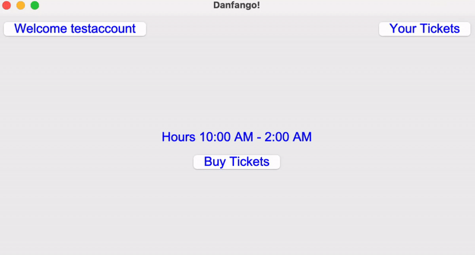
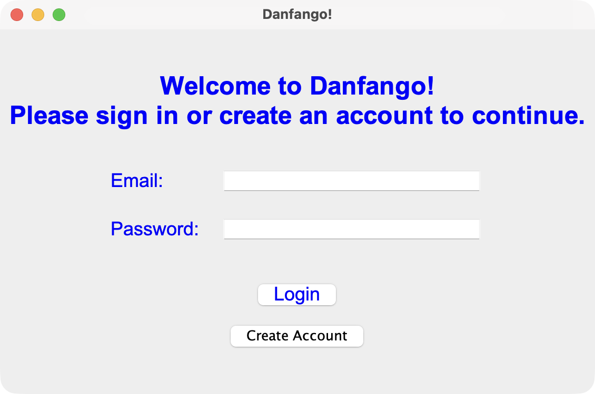
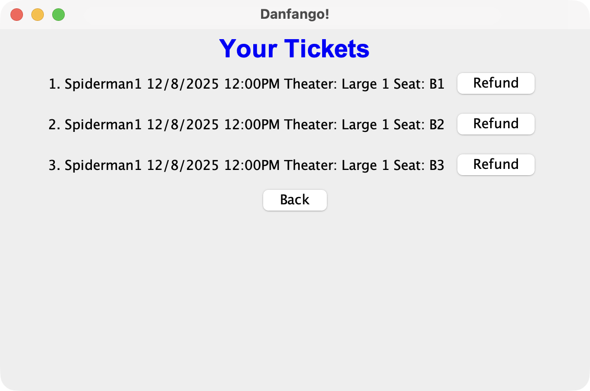
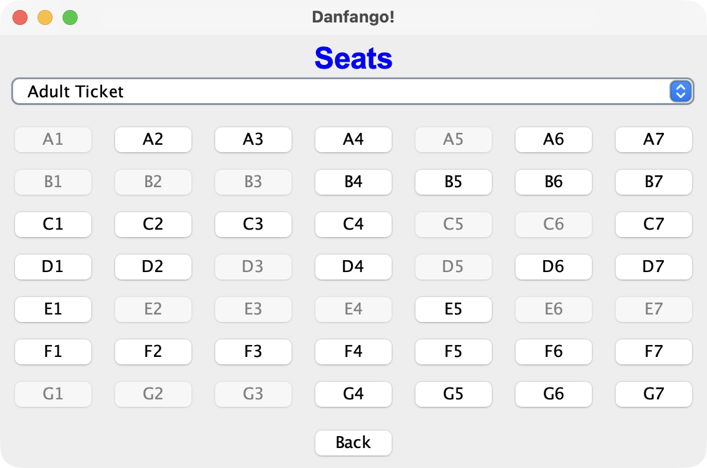
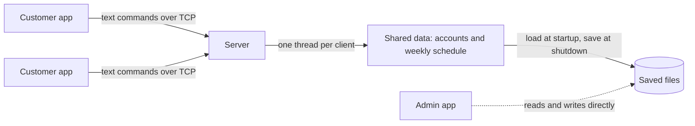

# DanFango: Movie Ticketing App

A desktop app for booking movie tickets, built in Java by a team of four for CS 180 at Purdue (Fall 2025). Customers pick a showtime, choose seats on a seat map, pay with a saved card, and manage or refund their tickets. Several customers can use it at the same time through a shared server.

> **The source code is private** because course policy doesn't allow posting it. I'm happy to walk through it or share it privately on request.

| Login | Seat map | Your tickets |
|---|---|---|
|  |  |  |

## At a glance

- **Tech:** Java, Swing, TCP sockets, multithreading, Java serialization, JUnit
- **Course:** CS 180: Problem Solving and Object-Oriented Programming, Purdue University, Fall 2025
- **Team:** 4 students
- **My part:** the customer app, the server it connects to, saving and loading data, and making the server work with multiple users

## What it does

- Create an account (with email, password strength and birthday checks) and log in
- Browse a week of showtimes; R-rated movies are hidden from users under 17
- Pick seats on a seat map as an adult, child or senior ticket, each with its own price
- Rent out a whole theater for a showing if no seats have been sold yet
- Save credit cards to an account and pay with them
- View your tickets and refund them, which frees the seat
- Change account details or delete the account
- A separate admin app lets staff manage theaters, ticket prices and movies

## My role

- Built the entire customer app in Swing: login and signup, showtimes, the seat map, checkout, the ticket list with refunds, and account and card settings
- Built the server the app connects to: a text command protocol over sockets, one thread per connected client, and locking around shared account and schedule data
- Wrote the code that saves and loads accounts and the weekly schedule using Java serialization
- Earlier in the project, built the console version of the app, which set the screens and flow the app later followed, along with its tests
- Changed the existing classes (accounts, schedule, movies, theaters) to work with the app and server, and fixed synchronization and data-saving bugs in them

**Teammates**

- **Snehil:** the admin app, the project's first client-server networking, and many of the unit tests
- **Jeremiah:** the core classes for credit cards, movies, seats and the weekly schedule, the interfaces, the first text-file database, and their tests
- **Arjun:** the ticket types and parts of the theater classes, and the project report

## How it works

- The customer app and the server talk over a TCP socket with simple text commands such as `Login`, `Show Seats`, `Bought Seat` and `Refund Ticket`, each followed by its data on separate lines.
- The server starts a new thread for each client. Each account has its own lock, and the weekly schedule (movies, theaters and seats) has one shared lock, so clients changing the same data take turns.
- When the server starts, it loads accounts and the schedule from saved files. A shutdown hook saves them when the server stops.
- The admin app is a separate program that reads and writes the schedule file directly, so it is run while the server is off.

## What I learned

The hardest part was concurrency. Putting a lock around shared data isn't enough on its own. Booking a seat means checking that the seat is free and then marking it taken, and if those two steps aren't one atomic action, two customers can both pass the check before either one takes the seat. Making a server safe for many users means deciding which steps have to happen together, not just which data needs a lock.

## Known limitations and next steps

| Limitation | What I'd do next |
|---|---|
| Two customers can book the same seat, because checking the seat and booking it aren't one atomic step. | Check and book the seat inside a single lock. |
| The card is charged before the final seat check, so a customer who loses the seat to someone else is still charged. | Hold the seat first, then charge the card, then confirm the booking. |
| Passwords are stored as plain text. | Store salted password hashes. |
| Network calls run on the Swing event thread, so the window can freeze while waiting for the server. | Move network calls to a background thread with `SwingWorker`. |
| Data is saved only when the server shuts down cleanly, so a crash loses changes. | Save after each change. |

## Contact

- LinkedIn: [your LinkedIn URL]
- Email: [your email]
- Resume: [link, optional]
